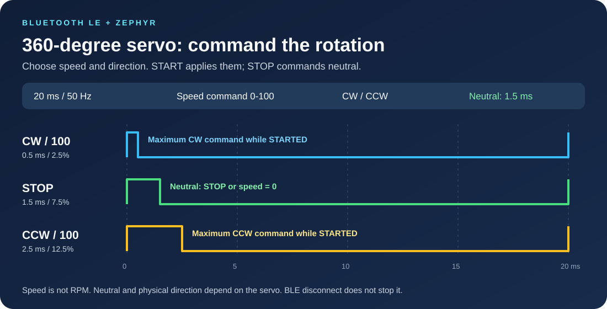
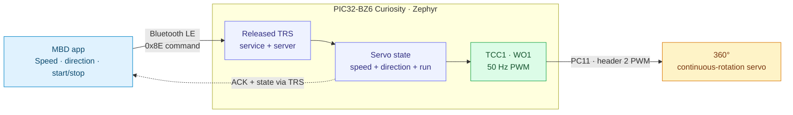
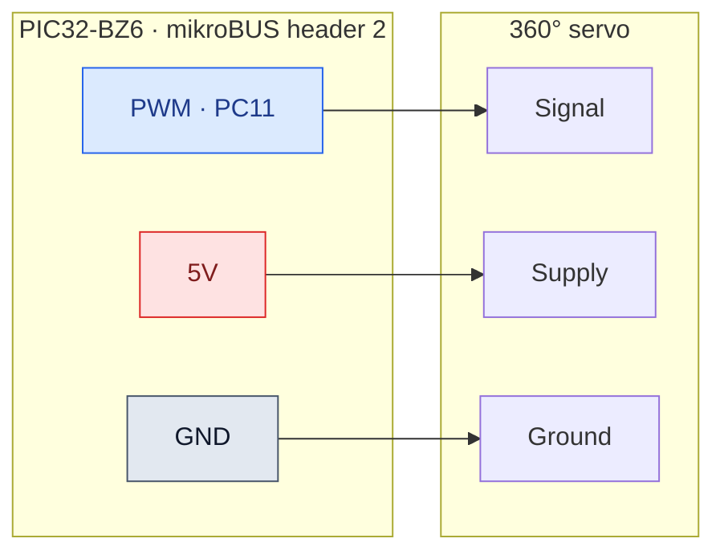
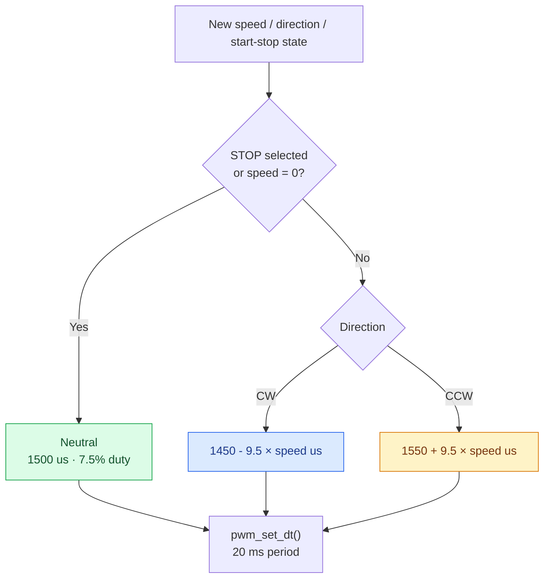
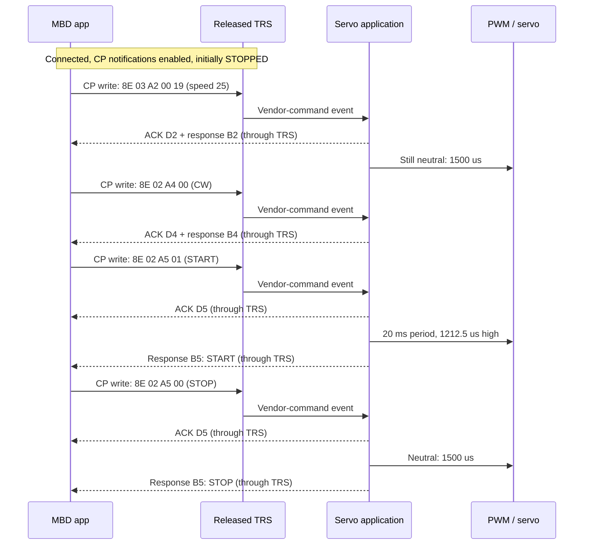

<div align="center">

# Bluetooth LE 360° Servo Motor Control

**Wireless speed and direction. Powered by Zephyr.**

PIC32-BZ6 Curiosity &nbsp; | &nbsp; Bluetooth LE &nbsp; | &nbsp; 50 Hz PWM &nbsp; | &nbsp; CW / CCW

[Get started](#3-software-setup) · [Wire the board](#4-hardware-setup) · [Understand PWM](#6-how-pwm-controls-speed-and-direction) · [Run with MBD](#8-run-the-demo-with-mbd)

</div>



## Disclaimer

This example is provided **“AS IS”** as a starting point for development and
self-support. Verify the servo's electrical ratings and mechanical behavior
before use. Firmware speed values are commands, not measured RPM.

[Microchip technical support](https://www.microchip.com/en-us/support) ·
[Companion 180° application](https://github.com/MicrochipTech/Bluetooth_LE_180_Servo_Motor_Control)

## Contents

1. [Introduction](#1-introduction)
2. [Bill of materials](#2-bill-of-materials)
3. [Software setup](#3-software-setup)
4. [Hardware setup](#4-hardware-setup)
5. [Zephyr application configuration](#5-zephyr-application-configuration)
6. [How PWM controls speed and direction](#6-how-pwm-controls-speed-and-direction)
7. [Board programming](#7-board-programming)
8. [Run the demo with MBD](#8-run-the-demo-with-mbd)
9. [BLE commands and data flow](#9-ble-commands-and-data-flow)
10. [Validation and troubleshooting](#10-validation-and-troubleshooting)
11. [Project map and references](#11-project-map-and-references)

## 1. Introduction

Control a compatible **360° continuous-rotation servo** wirelessly from the
Microchip Bluetooth Data (MBD) app. Choose a speed command, select clockwise or
counterclockwise direction, and start or stop rotation. The board translates BLE
commands into hardware-generated PWM.

This application builds on the **Microchip Transparent Profile (TRP)** published
in [Zephyr4Microchip/zephyr](https://github.com/Zephyr4Microchip/zephyr/tree/bb83b6cd729c963eb5fee17caa26ef33aba5332a/samples/bluetooth/peripheral_trp_uart).
It uses the TRP service/server for BLE communication and adds the **360° servo
command interface and PWM speed, direction, and start/stop control**.

| TRP source baseline | Version / revision |
| :-- | :-- |
| Zephyr version | **4.2.0** |
| Microchip branch | **`mchp_pic32cxbz_v420`** |
| Exact revision used | **`bb83b6cd729c963eb5fee17caa26ef33aba5332a`** |

The TRP revision used here is a branch commit, not a tagged release. The older
`pic32cxbz_v420_v1.2.0` tag does not include this TRP implementation; use the
revision above to reproduce this application.

| At a glance | Application behavior |
| :-- | :-- |
| BLE advertising name | `Zephyr_Servo-360` |
| Servo UI name / type | `SERVO 360` / `0x01` |
| Speed slider | Integer commands from **0 to 100**; not RPM |
| Direction | **CW = 0**, **CCW = 1** in the firmware convention |
| Start/stop | **STOP = 0**, **START = 1** |
| Startup state | Speed setting **50**, direction **CW**, **STOPPED** |
| PWM output | **PC11 / TCC1 WO1**, mikroBUS header 2 PWM |
| PWM timing | **20 ms period / 50 Hz**; neutral is **1.5 ms** |
| Feedback | Command ACKs and software-state responses; no speed sensor |



> [!IMPORTANT]
> **360° describes continuous rotation, not an angle command.** This firmware
> does not position the shaft at a requested angle or measure its speed.

## 2. Bill of materials

| Item | Quantity | Notes |
| :-- | :--: | :-- |
| [PIC32-BZ6 Curiosity board](https://www.microchip.com/en-us/development-tool/ev31u42a) | 1 | Target: `pic32wm_bz6204_curiosity/pic32cx2051bz62132` |
| Compatible 360° continuous-rotation servo | 1 | Verify supply, signal-level, neutral pulse, and current requirements |
| USB data cable | 1 | Board programming and serial connection |
| Jumper wires | 3 | Signal, supply, and ground |
| BLE-capable phone with MBD | 1 | A version supporting the servo command interface |
| Suitable regulated servo supply | As needed | Use an external supply if the board's available current is insufficient |

Model names alone do not establish that a servo is continuous-rotation; confirm
the exact variant. For position control, use the
[180° application](https://github.com/MicrochipTech/Bluetooth_LE_180_Servo_Motor_Control).

## 3. Software setup

Start with Microchip's **[Workbench for Zephyr setup guide](https://github.com/Zephyr4Microchip/zephyr-wireless/blob/main/docs/Workbench_for_Zephyr.md)**.
It covers the IDE, workspace, device libraries, custom OpenOCD installation,
programmer firmware switching, application import, building, and flashing.

| Setup stage | Instructions |
| :-- | :-- |
| Install VS Code and Workbench for Zephyr | [Install the extension](https://github.com/Zephyr4Microchip/zephyr-wireless/blob/main/docs/Workbench_for_Zephyr.md#step3) |
| Install host tools, initialize the workspace, and import SDK 0.17.4 | [Zephyr environment setup](https://github.com/Zephyr4Microchip/zephyr-wireless/blob/main/docs/Workbench_for_Zephyr.md#step4) |
| Fetch Microchip device libraries | [Install device libraries](https://github.com/Zephyr4Microchip/zephyr-wireless/blob/main/docs/Workbench_for_Zephyr.md#step5) |
| Install custom OpenOCD and switch the onboard programmer | [OpenOCD and CMSIS-DAP setup](https://github.com/Zephyr4Microchip/zephyr-wireless/blob/main/docs/Workbench_for_Zephyr.md#step6) |

| Component | Baseline |
| :-- | :-- |
| Zephyr source | [Zephyr4Microchip/zephyr · mchp_pic32cxbz_v420](https://github.com/Zephyr4Microchip/zephyr/tree/bb83b6cd729c963eb5fee17caa26ef33aba5332a) |
| Pinned revision | `bb83b6cd729c963eb5fee17caa26ef33aba5332a` |
| Zephyr / SDK | **4.2.0 / 0.17.4** |
| Build environment | West, CMake, Ninja, Python; see the [Zephyr setup guide](https://docs.zephyrproject.org/latest/develop/getting_started/index.html) |
| IDE option | VS Code with Zephyr Workbench |
| Flash tool | [Microchip OpenOCD](https://github.com/MicrochipTech/openOCD-wireless) configured for the board |
| Mobile app | Microchip Bluetooth Data (MBD); screen layout depends on app version |
| Optional debug tool | Serial terminal connected to the board's configured UART |

From an **initialized workspace using the pinned Zephyr checkout**, synchronize
the dependencies and obtain the required Microchip blobs:

```powershell
west update
west blobs fetch hal_microchip
git clone https://github.com/MicrochipTech/Bluetooth_LE_360_Servo_Motor_Control.git applications\Bluetooth_LE_360_Servo_Motor_Control
```

Run these commands in the intended workspace, not an unrelated shared workspace.
Its manifest must refer to the pinned release. The application repository alone
does not contain Zephyr, its modules, or the toolchain.

> [!TIP]
> The branch name alone is not enough: an older local checkout of the same branch
> may not contain the released TRS subsystem. Check the commit and ensure your
> build selects that checkout if multiple Zephyr packages are installed.

## 4. Hardware setup

**The 180° and 360° demos use the same three-wire connection on mikroBUS header 2.**
The setup used here takes PWM, 5 V, and GND from that header.

| PIC32-BZ6 Curiosity connection | Servo connection | Purpose |
| :-- | :-- | :-- |
| **mikroBUS header 2 — PWM** | PWM / signal input | PC11, routed as **TCC1 WO1** |
| **mikroBUS header 2 — 5V** | Servo supply input | Only for a servo rated for 5 V and within the board power budget |
| **mikroBUS header 2 — GND** | Servo ground | Common signal and power reference |



> [!WARNING]
> Check the board and servo current ratings, including servo stall current. Do
> not assume the board's 5 V header can supply every servo. If an external supply
> is required, connect its ground to board ground and avoid tying its output to
> the board's 5 V rail unless the power arrangement explicitly permits it.
> Never connect a 5 V supply to the MCU signal pin.

Connect wiring with power removed. Verify servo pin functions from its datasheet;
wire colors are not a reliable specification. Start with the servo unloaded and
the rotating parts clear. Hardware photos can be added alongside these diagrams
without changing the documented pin mapping.

## 5. Zephyr application configuration

Zephyr uses Kconfig for features, devicetree for routing, and its PWM API for
pulse updates.

| Layer | Configuration / source | Role |
| :-- | :-- | :-- |
| BLE + released TRS | [prj.conf](prj.conf) | Enables Bluetooth peripheral, TRS service/server, dynamic GATT, and buffers |
| Servo type | [Kconfig](Kconfig) | Selects the 360° application |
| PWM route | [BZ6 board overlay](boards/pic32wm_bz6204_curiosity.overlay) | `pwm-servo` alias, TCC1 channel 1, PC11, 20,000,000 ns period |
| Command integration | [main.c](src/main.c) | Advertising, TRS event dispatch, UART bridge, and servo command forwarding |
| Speed-to-pulse mapping | [Servo implementation](src/app_servo_motor_360.c) | State/range validation, ACKs/responses, and `pwm_set_dt()` |
| Command definitions | [Servo header](src/app_servo_motor_360.h) | Opcodes, request/response IDs, direction, and start/stop values |

```ini
CONFIG_BT_TRS=y
CONFIG_BT_TRS_SERVER=y
CONFIG_BT_GATT_DYNAMIC_DB=y
CONFIG_GPIO=y
CONFIG_PWM=y
```

BLE is configured for one connection, a target ATT MTU of 247, and
16 TRS receive buffers of 244 bytes. The actual MTU is negotiated with the phone.
Persistent bond storage is not enabled.

## 6. How PWM controls speed and direction

### Fixed frequency, neutral-centered control

The timer period remains **20 ms**, or **50 Hz**. The high pulse width determines
the firmware's direction/speed command:

| Pulse region | Firmware intent |
| :-- | :-- |
| **Below 1.5 ms** | Clockwise command |
| **1.5 ms** | Neutral / stop command |
| **Above 1.5 ms** | Counterclockwise command |

Direction is the firmware convention; actual rotation and speed depend on the
servo and viewing direction. The slider is a **0–100 command scale**, not
degrees, RPM, measured speed, or PWM duty-cycle percentage.



### Firmware mapping

```text
If STOP selected or speed s = 0:
    Pulse = 1500 us
Otherwise, for integer speed s = 1 to 100:
    CW pulse  = 1450 - 9.5 × s us
    CCW pulse = 1550 + 9.5 × s us

Duty cycle (%) = pulse width (us) / 20,000 × 100
```

**The following running values apply only when START is selected:**

| Speed command | CW pulse | CW duty | CCW pulse | CCW duty |
| --: | --: | --: | --: | --: |
| **0** | **1500 us** | **7.5000%** | **1500 us** | **7.5000%** |
| 1 | 1440.5 us | 7.2025% | 1559.5 us | 7.7975% |
| 25 | 1212.5 us | 6.0625% | 1787.5 us | 8.9375% |
| **50** | **975 us** | **4.8750%** | **2025 us** | **10.1250%** |
| 75 | 737.5 us | 3.6875% | 2262.5 us | 11.3125% |
| **100** | **500 us** | **2.5000%** | **2500 us** | **12.5000%** |
| **Any speed while STOPPED** | **1500 us** | **7.5000%** | **1500 us** | **7.5000%** |

At startup the stored speed is **50** and direction is **CW**, but the output is
**1500 us because the state is STOPPED**. Moving the slider while stopped stores
the new setting without requesting rotation. START applies the stored setting.

> [!IMPORTANT]
> Neutral remains a repeating **1.5 ms pulse**, not a 0% duty signal or a PWM
> disable. The mapping has an intentional gap around neutral: speed 0 commands
> 1500 us, while speed 1 commands 1440.5 or 1559.5 us. This is not a linear
> position mapping. Servo neutral/deadband and usable limits require calibration;
> a 1500 us command may not perfectly stop every continuous-rotation servo.

## 7. Board programming

### Option A — Zephyr Workbench

1. Complete the [Workbench setup and programmer-mode instructions](https://github.com/Zephyr4Microchip/zephyr-wireless/blob/main/docs/Workbench_for_Zephyr.md#step6).
2. Use **APPLICATIONS → Add Application → Import existing application** as
   described in the [import guide](https://github.com/Zephyr4Microchip/zephyr-wireless/blob/main/docs/Workbench_for_Zephyr.md#step7).
   Select this cloned repository as the project location.
3. In the **Board** selector, choose **`pic32wm_bz6204_curiosity`** and SDK
   **0.17.4**. If Workbench asks for the SoC qualifier, choose
   `pic32cx2051bz62132`. The full West board target is
   `pic32wm_bz6204_curiosity/pic32cx2051bz62132`.
4. Use the **Build** action against the pinned released Zephyr checkout; see
   [Build the application](https://github.com/Zephyr4Microchip/zephyr-wireless/blob/main/docs/Workbench_for_Zephyr.md#step8).
5. Use **Flash** and select the **`openocd`** runner; see
   [Flash the application](https://github.com/Zephyr4Microchip/zephyr-wireless/blob/main/docs/Workbench_for_Zephyr.md#step9).

### Onboard programmer: CMSIS-DAP versus MPLAB mode

The board's onboard programmer must use the mode appropriate to the tool:

| Development tool | Programmer mode | Selection in `switchFirmware.py` |
| :-- | :-- | :-- |
| Zephyr / custom OpenOCD | **CMSIS-DAP** | **1** or **`zephyr`** |
| MPLAB X IDE / IPE | **MPLAB PKOB4** | **2** or **`mplab`** |

Obtain `installOpenOCD_WSG_BZx.py` and `switchFirmware.py` from the links in the
[Microchip installation guide](https://github.com/Zephyr4Microchip/zephyr-wireless/blob/main/docs/Workbench_for_Zephyr.md#step6).
Follow its OpenOCD installation steps, then run the switcher from the directory
where you saved it:

```powershell
python switchFirmware.py
```

> [!WARNING]
> Connect **only one target board** when switching programmer firmware. Select
> **1 / `zephyr`** for CMSIS-DAP before using OpenOCD. Switch back with
> **2 / `mplab`** before returning to MPLAB X IDE/IPE. This switches the debugger
> firmware; it does not build or flash the servo application itself.

### Option B — West command line

From the workspace root with the pinned checkout selected:

```powershell
west build -b pic32wm_bz6204_curiosity/pic32cx2051bz62132 -d applications\Bluetooth_LE_360_Servo_Motor_Control\build\released applications\Bluetooth_LE_360_Servo_Motor_Control
west flash -d applications\Bluetooth_LE_360_Servo_Motor_Control\build\released
```

Builds are generated locally under `build/`, which is ignored by Git. No
precompiled image is required from this repository. When switching Zephyr
revisions, use a new build directory or a pristine build; do not flash a stale
image from an earlier configuration.

## 8. Run the demo with MBD

The table describes the firmware-facing workflow. Exact MBD menu names and
screenshots depend on the app version and can be added with the demo images.

| Step | Action in the setup / MBD app | Expected firmware behavior |
| :--: | :-- | :-- |
| 1 | Power and reset the programmed board | Neutral pulse; speed setting 50, CW, STOPPED |
| 2 | Open MBD, scan, and connect to **`Zephyr_Servo-360`** | Board establishes one BLE connection |
| 3 | Open the servo controls in a compatible MBD version | UI-update exchange identifies `SERVO 360`, type `0x01`, and current software state |
| 4 | Ensure Control Point notifications are enabled; a compatible app may manage this automatically | ACKs and servo responses can reach the phone |
| 5 | While stopped, choose a low speed setting and direction | Setting changes; output remains neutral |
| 6 | Select **START** | PWM uses the stored speed and direction |
| 7 | Adjust speed; stop before changing direction during initial testing | Running output follows the selected mapping |
| 8 | Select **STOP** before ending the demo | Output returns to the 1.5 ms neutral command |

For a manual BLE client, enable Control Point notifications **before** sending
commands. Use hexadecimal byte writes, not ASCII text. The UI-update request is
`8E 01 A1`; a speed-25 request is `8E 03 A2 00 19`.

> [!WARNING]
> **BLE disconnection does not stop the servo.** The last PWM command remains
> active. STOP must be sent while connected, and radio connectivity is not an
> emergency-stop mechanism. Provide a suitable independent power-disconnect
> method for the test setup.

## 9. BLE commands and data flow

### From a speed setting to rotation



ACK means the request reached the application path; it is **not** measured speed
feedback or proof that the PWM hardware succeeded. Check errors and actual servo
behavior during validation.

### Transport channels

| Characteristic | Phone action | Board action |
| :-- | :-- | :-- |
| **Control Point (CP)** | Write servo frames; subscribe for responses | Executes `0x8E` commands; sends ACKs, responses, and CBFC messages |
| **RX data** | Write transparent bytes | Forwards bytes to UART TX, without executing servo commands |
| **TX data** | Subscribe to notifications | Delivers UART-originated transparent data |

<details>
<summary><strong>GATT UUIDs and advertising identity</strong></summary>

| Item | Value |
| :-- | :-- |
| TRS service | `49535343-FE7D-4AE5-8FA9-9FAFD205E455` |
| TX characteristic | `49535343-1E4D-4BD9-BA61-23C647249616` |
| RX characteristic | `49535343-8841-43F4-A8D4-ECBE34729BB3` |
| Control Point characteristic | `49535343-4C8A-39B3-2F49-511CFF073B7E` |
| Advertising service-data bytes | `DA FE FF E1` |

Discover characteristics by UUID rather than relying on fixed ATT handles.

</details>

### Servo packet format

All examples below are **hexadecimal bytes on the BLE Control Point**:

```text
 Byte 0       Byte 1             Byte 2        Bytes 3...
+----------+------------------+-------------+-------------------+
| 8E       | LENGTH           | COMMAND ID  | COMMAND DATA      |
+----------+------------------+-------------+-------------------+
 Servo       Bytes after        A1 / A2 /     Speed / direction /
 opcode      LENGTH             A4 / A5       start-stop
```

Speed is an unsigned **16-bit big-endian** value: high byte first. Direction
and start/stop use one byte each.

| Phone request | Raw request example | ACK | Main response |
| :-- | :-- | :-- | :-- |
| Read UI / state | `8E 01 A1` | `8E 01 D1` | `0xB1` UI response |
| Speed → 0 | `8E 03 A2 00 00` | `8E 01 D2` | `8E 03 B2 00 00` |
| Speed → 25 | `8E 03 A2 00 19` | `8E 01 D2` | `8E 03 B2 00 19` |
| Speed → 50 | `8E 03 A2 00 32` | `8E 01 D2` | `8E 03 B2 00 32` |
| Speed → 100 | `8E 03 A2 00 64` | `8E 01 D2` | `8E 03 B2 00 64` |
| Direction → CW | `8E 02 A4 00` | `8E 01 D4` | `8E 02 B4 00` |
| Direction → CCW | `8E 02 A4 01` | `8E 01 D4` | `8E 02 B4 01` |
| START | `8E 02 A5 01` | `8E 01 D5` | `8E 02 B5 01` |
| STOP | `8E 02 A5 00` | `8E 01 D5` | `8E 02 B5 00` |

Setting speed to zero also commands neutral, but does not change the stored
START/STOP field. Increasing speed again while START remains selected resumes
the running pulse mapping. A direction change while running applies immediately;
the firmware does not insert a stop or ramp.

<details>
<summary><strong>UI response layout and initial example</strong></summary>

```text
8E | LENGTH | B1 | NAME_LENGTH | NAME bytes | TYPE | SPEED_H | SPEED_L | DIRECTION | START_STOP
```

Initial state (`SERVO 360`, type 1, speed 50, CW, STOPPED):

```text
8E 10 B1 09 53 45 52 56 4F 20 33 36 30 01 00 32 00 00
```

The module defines `0xC2`, `0xC4`, and `0xC5` notification helpers, but its current
request handlers use the corresponding `0xB2`, `0xB4`, and `0xB5` responses rather
than calling those helpers. State fields are software state, not sensor readings.

</details>

### Optional UART bridge

| Input / condition | Behavior |
| :-- | :-- |
| UART text ending in CR or LF | Sent over TX data notifications, without the delimiter |
| UART hex line starting with `8E` | Decoded and sent to the phone through CP; not executed locally as a servo command |
| UART line limit | 128 characters; four completed lines can be queued |
| Oversize line / queue overflow | Line discarded or dropped with a log message |
| UART-to-BLE payload size | Up to `ATT MTU - 4`: 19 bytes at MTU 23; 243 bytes at MTU 247 |
| Temporary TX backpressure | Pending UART data retried; TX-open and CBFC-credit events restart the pump |

## 10. Validation and troubleshooting

**The migrated application has been built, flashed, and reported working on
PIC32-BZ6 hardware.** This is a functional result, not a claim that every stress
or boundary case below has been tested.

| Check | Expected result |
| :-- | :-- |
| Startup | Neutral output with speed 50, CW, STOPPED in software state |
| Change settings while stopped | Stored settings update; neutral remains |
| START / STOP | Running mapping / 1500 us neutral |
| Speed 0 / 25 / 50 / 100 | Pulse widths match the mapping table |
| Direction | CW and CCW commands produce the expected physical behavior for the servo |
| Reconnect | Device can be rediscovered and commands resume |
| Extended tests | Verify MTU limits, notification toggles, CBFC replenishment, and burst traffic |

| Symptom | Check |
| :-- | :-- |
| Device not visible | Correct image, power, Bluetooth permissions, and advertising name |
| Connects but controls do nothing | Compatible MBD interface, CP writes, and CP notification subscription |
| Slider changes but motor stays still | STOP state, speed zero, power, and neutral/deadband calibration |
| Motor creeps while stopped | Servo neutral calibration; firmware commands a fixed 1500 us |
| Direction appears reversed | Servo convention and viewing direction |
| Speed is not proportional to the slider | Mapping is open-loop; load and servo electronics determine actual speed |
| Resets or erratic movement | Power/current budget, common ground, supply droop, and loose wiring |
| Motor keeps running after disconnect | Expected: no automatic stop-on-disconnect is implemented |
| Missing UART data | Delimiters, connection/subscription state, queue-overflow logs, and flow control |

## 11. Project map and references

```text
Bluetooth_LE_360_Servo_Motor_Control/
|-- README.md
|-- CMakeLists.txt
|-- Kconfig
|-- prj.conf
|-- sample.yaml
|-- boards/
|   `-- pic32wm_bz6204_curiosity.overlay
|-- docs/
|   `-- pwm-speed.svg
`-- src/
    |-- main.c
    |-- app_servo_motor_360.c
    `-- app_servo_motor_360.h
```

The project map highlights the BZ6 path documented here. An additional WBZ451
overlay is present, but the reported hardware validation is for BZ6.

- [Released Transparent UART sample](https://github.com/Zephyr4Microchip/zephyr/tree/bb83b6cd729c963eb5fee17caa26ef33aba5332a/samples/bluetooth/peripheral_trp_uart)
- [Microchip Workbench for Zephyr guide](https://github.com/Zephyr4Microchip/zephyr-wireless/blob/main/docs/Workbench_for_Zephyr.md) — setup, CMSIS-DAP switching, import, build, and flash.
- [Released TRS subsystem](https://github.com/Zephyr4Microchip/zephyr/tree/bb83b6cd729c963eb5fee17caa26ef33aba5332a/subsys/bluetooth/services/trs)
- [Zephyr PWM API](https://docs.zephyrproject.org/4.2.0/hardware/peripherals/pwm.html)
- [Microchip Transparent UART testing guide](https://onlinedocs.microchip.com/oxy/GUID-A5330D3A-9F51-4A26-B71D-8503A493DF9C-en-US-11/GUID-07EC83B7-CC28-4C55-8634-4B7F56A9DB36.html)
