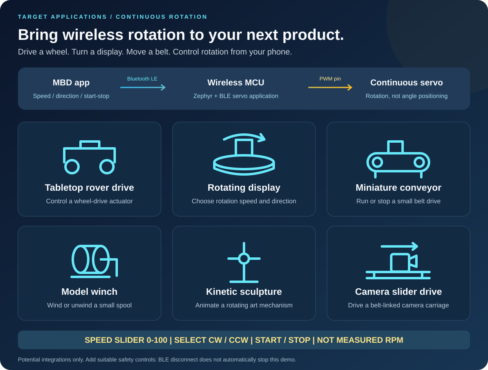
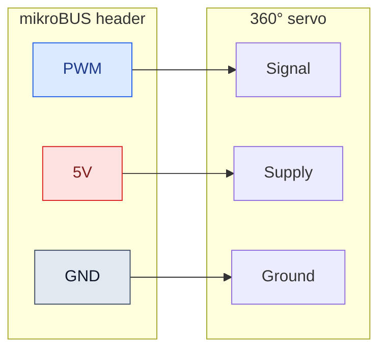
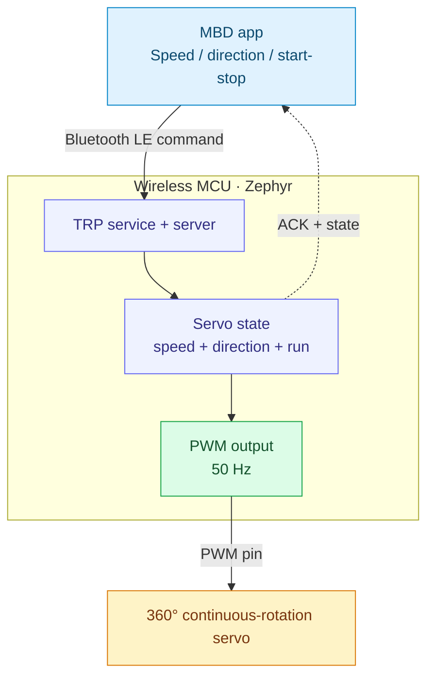
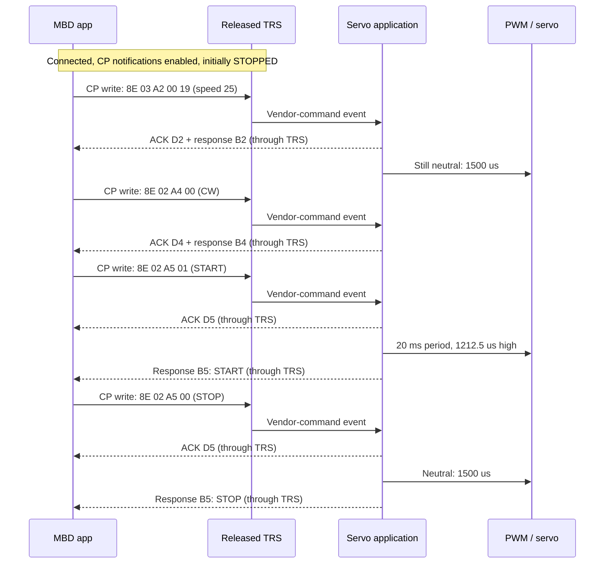
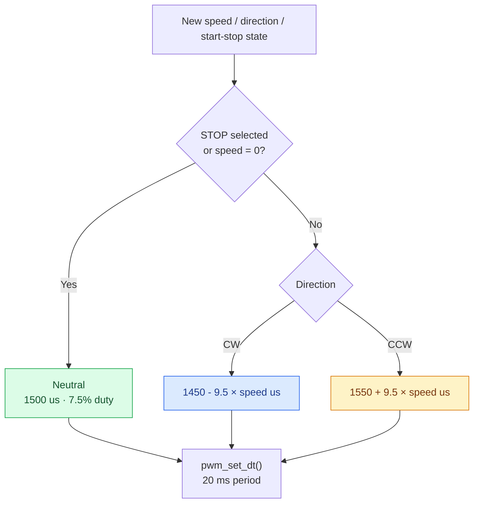

<div align="center">

# Bluetooth LE 360° Servo Motor Control

**Wireless speed and direction. Powered by Zephyr.**

Wireless MCU &nbsp; | &nbsp; Bluetooth LE &nbsp; | &nbsp; 50 Hz PWM &nbsp; | &nbsp; CW / CCW

[Set up Zephyr](#41-prerequisites) · [Import](#42-import-the-application) · [Build](#44-build-the-application) · [Flash](#45-program-the-board) · [Run with MBD](#6-demo-setup-and-operation)

</div>

**Contents**

1. [Introduction](#1-introduction)
2. [Target Segments and Applications](#2-target-segments-and-applications)
3. [Hardware Setup](#3-hardware-setup)
4. [Zephyr Software Setup](#4-zephyr-software-setup)
   - [Prerequisites](#41-prerequisites)
   - [Import the application](#42-import-the-application)
   - [Application configuration](#43-application-configuration)
   - [Build](#44-build-the-application)
   - [Program](#45-program-the-board)
   - [File structure](#46-file-structure)
5. [Application Architecture and Control Principles](#5-application-architecture-and-control-principles)
   - [Control architecture](#51-control-architecture)
   - [BLE data flow and commands](#52-ble-data-flow-and-commands)
   - [PWM and motor control](#53-pwm-and-motor-control)
6. [Demo Setup and Operation](#6-demo-setup-and-operation)
7. [Validation and Troubleshooting](#7-validation-and-troubleshooting)


## 1. Introduction

Control a compatible **360° continuous-rotation servo** wirelessly from the
Microchip Bluetooth Data (MBD) app. Choose a speed command, select clockwise or
counterclockwise direction, and start or stop rotation. The board translates BLE
commands into hardware-generated PWM.

> **Speed control in both directions:** Move the MBD slider to set the rotation
> speed command from **0 to 100** in either **CW or CCW**. Select direction
> separately, then use **START/STOP** to run or stop. Speed **0** commands neutral;
> the scale is **not measured RPM**.
>
> **Tested hardware:** Tower Pro **MG996R 360° continuous-rotation servo**, operated at **5 V**.

### Disclaimer

This example is provided **“AS IS”** as a starting point for development and
self-support. Verify the servo's electrical ratings and mechanical behavior
before use. Firmware speed values are commands, not measured RPM.

[Microchip technical support](https://www.microchip.com/en-us/support) ·
[Companion 180° application](https://github.com/MicrochipTech/Bluetooth_LE_180_Servo_Motor_Control)

## 2. Target Segments and Applications



### Potential end products

| Target application | What continuous rotation enables |
| :-- | :-- |
| Tabletop rover drive | Control a wheel-drive actuator's speed setting and direction |
| Rotating display | Run a turntable in either direction at an adjustable speed setting |
| Miniature conveyor | Start, stop, and reverse a small belt-drive mechanism |
| Model winch | Wind or unwind a small spool with suitable travel limits |
| Kinetic sculpture | Animate a rotating art mechanism |
| Camera slider drive | Drive a belt-linked camera carriage with suitable end stops |

These are **integration ideas**, not validated complete products. The demo
controls one servo, not a complete multi-wheel rover. Product mechanics, power,
and independent safety controls must be designed separately.
Travel-limited mechanisms need independent limit switches and stopping controls;
this firmware does not track position or implement end-of-travel detection.

> 📌 **Important**
>
> **360° describes continuous rotation, not an angle command.** This firmware
> does not position the shaft at a requested angle or measure its speed.

## 3. Hardware Setup

### Bill of materials

| Item | Quantity | Notes |
| :-- | :--: | :-- |
| [PIC32-BZ6 Curiosity board](https://www.microchip.com/en-us/development-tool/ev31u42a) | 1 | Only supported board: `pic32wm_bz6204_curiosity/pic32cx2051bz62132` |
| Tower Pro MG996R 360° continuous-rotation servo | 1 | Tested at **5 V**; verify the exact unit's supply, signal-level, neutral pulse, and current requirements |

> 📌 **Important — Servo power supply**
>
> Use a suitable regulated external servo supply if the board's available current
> is insufficient. Verify the servo's current requirements, including stall
> current, and connect the external supply ground to board ground.

Model names alone do not establish that a servo is continuous-rotation; confirm
the exact variant. For position control, use the
[180° application](https://github.com/MicrochipTech/Bluetooth_LE_180_Servo_Motor_Control).

### Wiring

**Connect the 360° continuous-rotation servo to mikroBUS header 2 as shown below.**
The setup used here takes PWM, 5 V, and GND from that header.

| PIC32-BZ6 Curiosity connection | Servo connection | Purpose |
| :-- | :-- | :-- |
| **mikroBUS header 2 — PWM** | PWM / signal input | PC11, routed as **TCC1 WO1** |
| **mikroBUS header 2 — 5V** | Servo supply input | Only for a servo rated for 5 V and within the board power budget |
| **mikroBUS header 2 — GND** | Servo ground | Common signal and power reference |



> ⚠️ **Warning**
>
> Check the board and servo current ratings, including servo stall current. Do
> not assume the board's 5 V header can supply every servo. If an external supply
> is required, connect its ground to board ground and avoid tying its output to
> the board's 5 V rail unless the power arrangement explicitly permits it.
> Never connect a 5 V supply to the MCU signal pin.

Connect wiring with power removed. Verify servo pin functions from its datasheet;
wire colors are not a reliable specification. Start with the servo unloaded and
the rotating parts clear. Hardware photos can be added alongside these diagrams
without changing the documented pin mapping.

## 4. Zephyr Software Setup

### 4.1 Prerequisites

Complete the [Zephyr Wireless environment setup](https://github.com/Zephyr4Microchip/zephyr-wireless#2-environment-setup)
using either of the two supported workflows:

- **Workbench (VS Code):** Follow the [Workbench for Zephyr guide](https://github.com/Zephyr4Microchip/zephyr-wireless/blob/main/docs/Workbench_for_Zephyr.md).
- **Command line (CLI):** Follow the [command-line setup instructions](https://github.com/Zephyr4Microchip/zephyr-wireless#legacy-command-line).

Use those guides for host tools, workspace and SDK installation, Microchip
libraries, OpenOCD, and programmer-mode setup. Use a Zephyr checkout containing
the released TRP service/server and SDK **0.17.4** for this application.

**Supported board:** PIC32-BZ6 Curiosity only — **`pic32wm_bz6204_curiosity`**.

#### Setup guide and supporting references

Complete the environment setup before importing the application. The TRP,
PWM, and testing links below are supporting references, not extra installation
steps.

- [Microchip Workbench for Zephyr guide](https://github.com/Zephyr4Microchip/zephyr-wireless/blob/main/docs/Workbench_for_Zephyr.md) — setup, CMSIS-DAP switching, import, build, and flash.
- [Released Transparent UART sample](https://github.com/Zephyr4Microchip/zephyr/tree/bb83b6cd729c963eb5fee17caa26ef33aba5332a/samples/bluetooth/peripheral_trp_uart) — TRP application baseline.
- [Released TRS subsystem](https://github.com/Zephyr4Microchip/zephyr/tree/bb83b6cd729c963eb5fee17caa26ef33aba5332a/subsys/bluetooth/services/trs) — BLE service and server implementation.
- [Zephyr PWM API](https://docs.zephyrproject.org/4.2.0/hardware/peripherals/pwm.html) — pulse-generation API used by the servo application.
- [Microchip Transparent UART testing guide](https://onlinedocs.microchip.com/oxy/GUID-A5330D3A-9F51-4A26-B71D-8503A493DF9C-en-US-11/GUID-07EC83B7-CC28-4C55-8634-4B7F56A9DB36.html) — transport testing reference.

### 4.2 Import the application

#### Clone into the workspace

After completing the setup prerequisites, clone the application from your
workspace's `applications` directory:

```powershell
git clone https://github.com/MicrochipTech/Bluetooth_LE_360_Servo_Motor_Control.git
```

Run these commands in the intended workspace, not an unrelated shared workspace.
The application repository alone
does not contain Zephyr, its modules, or the toolchain.

> 💡 **Tip**
>
> The branch name alone is not enough: an older local checkout of the same branch
> may not contain the released TRS subsystem. Check the commit and ensure your
> build selects that checkout if multiple Zephyr packages are installed.

#### Workbench

Follow [Import existing application in Workbench](https://github.com/Zephyr4Microchip/zephyr-wireless/blob/main/docs/Workbench_for_Zephyr.md#7-import-existing-application).
Select the cloned `applications\Bluetooth_LE_360_Servo_Motor_Control` folder.
Choose board **`pic32wm_bz6204_curiosity`**, SoC qualifier
**`pic32cx2051bz62132`** if requested, and SDK **0.17.4**.

#### CLI

No IDE import is required. After cloning, use the application path as the source
argument to `west build` in [Build the application](#44-build-the-application).
See the [Zephyr Wireless CLI workflow](https://github.com/Zephyr4Microchip/zephyr-wireless#legacy-command-line)
for workspace and shell setup.

### 4.3 Application configuration

This application builds on the **Microchip Transparent Profile (TRP)** available
through [Zephyr Wireless](https://github.com/Zephyr4Microchip/zephyr-wireless),
using the [released Transparent UART sample](https://github.com/Zephyr4Microchip/zephyr/tree/bb83b6cd729c963eb5fee17caa26ef33aba5332a/samples/bluetooth/peripheral_trp_uart).
It uses the TRP service/server for BLE communication and adds the **360° servo
command interface and PWM speed, direction, and start/stop control**.

Zephyr uses Kconfig for features, devicetree for routing, and its PWM API for
pulse updates.

| Layer | Configuration / source | Role |
| :-- | :-- | :-- |
| BLE + released TRS | [prj.conf](prj.conf) | Enables Bluetooth peripheral, TRS service/server, dynamic GATT, and buffers |
| Servo type | [Kconfig](Kconfig) | Selects the 360° application |
| PWM route | [BZ6 board overlay](boards/pic32wm_bz6204_curiosity.overlay) | `pwm-servo` alias, TCC1 channel 1, PC11, 20,000,000 ns period |
| Command integration | [main.c](src/main.c) | Advertising, TRS event dispatch, UART bridge, and servo command forwarding |
| Speed-to-pulse mapping | [Servo implementation](src/app_servo_motor_360.c) | State/range validation, ACKs/responses, and `pwm_set_dt()` |
| Command definitions | [Servo header](src/app_servo_motor_360.h) | Opcodes, request/response IDs, direction, and start/stop values |

```ini
CONFIG_BT_TRS=y
CONFIG_BT_TRS_SERVER=y
CONFIG_BT_GATT_DYNAMIC_DB=y
CONFIG_GPIO=y
CONFIG_PWM=y
```

BLE is configured for one connection, a target ATT MTU of 247, and
16 TRS receive buffers of 244 bytes. The actual MTU is negotiated with the phone.
Persistent bond storage is not enabled.

### 4.4 Build the application

#### Workbench

Follow [Build the application in Workbench](https://github.com/Zephyr4Microchip/zephyr-wireless/blob/main/docs/Workbench_for_Zephyr.md#step8)
using the board and SDK selected during import. Select a Zephyr checkout
containing the released TRP service/server.

#### CLI

Refer to [Zephyr Wireless — Building sample applications](https://github.com/Zephyr4Microchip/zephyr-wireless#3-building-sample-applications).
For this repository, use the following board and source path.

From the initialized workspace root:

```powershell
west build -b pic32wm_bz6204_curiosity/pic32cx2051bz62132 -d applications\Bluetooth_LE_360_Servo_Motor_Control\build\released applications\Bluetooth_LE_360_Servo_Motor_Control
```

Builds are generated locally under `build/`, which is ignored by Git. No
precompiled image is required from this repository. When switching Zephyr
revisions, use a new build directory or a pristine build; do not flash a stale
image from an earlier configuration.

### 4.5 Program the board

#### Workbench

Follow [Flash the application in Workbench](https://github.com/Zephyr4Microchip/zephyr-wireless/blob/main/docs/Workbench_for_Zephyr.md#step9)
and select the **`openocd`** runner. OpenOCD installation and CMSIS-DAP
programmer-mode switching are covered in the
[setup prerequisite](#41-prerequisites), not repeated here.

#### CLI

Refer to [West flashing and debugging](https://docs.zephyrproject.org/4.2.0/develop/west/build-flash-debug.html#flashing-west-flash).
Flash the build directory produced in the previous section:

```powershell
west flash -d applications\Bluetooth_LE_360_Servo_Motor_Control\build\released --runner openocd
```

### 4.6 File structure

```text
Bluetooth_LE_360_Servo_Motor_Control/
|-- README.md
|-- CMakeLists.txt
|-- Kconfig
|-- prj.conf
|-- sample.yaml
|-- boards/
|   `-- pic32wm_bz6204_curiosity.overlay
|-- docs/
|   |-- target-applications.svg
|   `-- pwm-speed.svg
`-- src/
    |-- main.c
    |-- app_servo_motor_360.c
    `-- app_servo_motor_360.h
```

## 5. Application Architecture and Control Principles

### 5.1 Control architecture

| At a glance | Application behavior |
| :-- | :-- |
| BLE advertising name | `Zephyr_Servo-360` |
| Servo UI name / type | `SERVO 360` / `0x01` |
| Speed slider | Integer commands from **0 to 100**; not RPM |
| Direction | **CW = 0**, **CCW = 1** in the firmware convention |
| Start/stop | **STOP = 0**, **START = 1** |
| Startup state | Speed setting **50**, direction **CW**, **STOPPED** |
| PWM output | **PC11 / TCC1 WO1**, mikroBUS header 2 PWM |
| PWM timing | **20 ms period / 50 Hz**; neutral is **1.5 ms** |
| Feedback | Command ACKs and software-state responses; no speed sensor |



Diagrams show generic functional connections. The hardware table and overlay
define the actual BZ6 pin mapping; no other board is currently supported.

### 5.2 BLE data flow and commands

#### From a speed setting to rotation



ACK means the request reached the application path; it is **not** measured speed
feedback or proof that the PWM hardware succeeded. Check errors and actual servo
behavior during validation.

#### Transport channels

| Characteristic | Phone action | Board action |
| :-- | :-- | :-- |
| **Control Point (CP)** | Write servo frames; subscribe for responses | Executes `0x8E` commands; sends ACKs, responses, and CBFC messages |
| **RX data** | Write transparent bytes | Forwards bytes to UART TX, without executing servo commands |
| **TX data** | Subscribe to notifications | Delivers UART-originated transparent data |

<details>
<summary><strong>GATT UUIDs and advertising identity</strong></summary>

| Item | Value |
| :-- | :-- |
| TRS service | `49535343-FE7D-4AE5-8FA9-9FAFD205E455` |
| TX characteristic | `49535343-1E4D-4BD9-BA61-23C647249616` |
| RX characteristic | `49535343-8841-43F4-A8D4-ECBE34729BB3` |
| Control Point characteristic | `49535343-4C8A-39B3-2F49-511CFF073B7E` |
| Advertising service-data bytes | `DA FE FF E1` |

Discover characteristics by UUID rather than relying on fixed ATT handles.

</details>

#### Servo packet format

All examples below are **hexadecimal bytes on the BLE Control Point**:

```text
 Byte 0       Byte 1             Byte 2        Bytes 3...
+----------+------------------+-------------+-------------------+
| 8E       | LENGTH           | COMMAND ID  | COMMAND DATA      |
+----------+------------------+-------------+-------------------+
 Servo       Bytes after        A1 / A2 /     Speed / direction /
 opcode      LENGTH             A4 / A5       start-stop
```

Speed is an unsigned **16-bit big-endian** value: high byte first. Direction
and start/stop use one byte each.

| Phone request | Raw request example | ACK | Main response |
| :-- | :-- | :-- | :-- |
| Read UI / state | `8E 01 A1` | `8E 01 D1` | `0xB1` UI response |
| Speed → 0 | `8E 03 A2 00 00` | `8E 01 D2` | `8E 03 B2 00 00` |
| Speed → 25 | `8E 03 A2 00 19` | `8E 01 D2` | `8E 03 B2 00 19` |
| Speed → 50 | `8E 03 A2 00 32` | `8E 01 D2` | `8E 03 B2 00 32` |
| Speed → 100 | `8E 03 A2 00 64` | `8E 01 D2` | `8E 03 B2 00 64` |
| Direction → CW | `8E 02 A4 00` | `8E 01 D4` | `8E 02 B4 00` |
| Direction → CCW | `8E 02 A4 01` | `8E 01 D4` | `8E 02 B4 01` |
| START | `8E 02 A5 01` | `8E 01 D5` | `8E 02 B5 01` |
| STOP | `8E 02 A5 00` | `8E 01 D5` | `8E 02 B5 00` |

Setting speed to zero also commands neutral, but does not change the stored
START/STOP field. Increasing speed again while START remains selected resumes
the running pulse mapping. A direction change while running applies immediately;
the firmware does not insert a stop or ramp.

<details>
<summary><strong>UI response layout and initial example</strong></summary>

```text
8E | LENGTH | B1 | NAME_LENGTH | NAME bytes | TYPE | SPEED_H | SPEED_L | DIRECTION | START_STOP
```

Initial state (`SERVO 360`, type 1, speed 50, CW, STOPPED):

```text
8E 10 B1 09 53 45 52 56 4F 20 33 36 30 01 00 32 00 00
```

The module defines `0xC2`, `0xC4`, and `0xC5` notification helpers, but its current
request handlers use the corresponding `0xB2`, `0xB4`, and `0xB5` responses rather
than calling those helpers. State fields are software state, not sensor readings.

</details>

#### Optional UART bridge

| Input / condition | Behavior |
| :-- | :-- |
| UART text ending in CR or LF | Sent over TX data notifications, without the delimiter |
| UART hex line starting with `8E` | Decoded and sent to the phone through CP; not executed locally as a servo command |
| UART line limit | 128 characters; four completed lines can be queued |
| Oversize line / queue overflow | Line discarded or dropped with a log message |
| UART-to-BLE payload size | Up to `ATT MTU - 4`: 19 bytes at MTU 23; 243 bytes at MTU 247 |
| Temporary TX backpressure | Pending UART data retried; TX-open and CBFC-credit events restart the pump |

### 5.3 PWM and motor control

#### How PWM controls speed and direction


##### Fixed frequency, neutral-centered control

The timer period remains **20 ms**, or **50 Hz**. The high pulse width determines
the firmware's direction/speed command:

| Pulse region | Firmware intent |
| :-- | :-- |
| **Below 1.5 ms** | Clockwise command |
| **1.5 ms** | Neutral / stop command |
| **Above 1.5 ms** | Counterclockwise command |

Direction is the firmware convention; actual rotation and speed depend on the
servo and viewing direction. The slider is a **0–100 command scale**, not
degrees, RPM, measured speed, or PWM duty-cycle percentage.



##### Firmware mapping

```text
If STOP selected or speed s = 0:
    Pulse = 1500 us
Otherwise, for integer speed s = 1 to 100:
    CW pulse  = 1450 - 9.5 × s us
    CCW pulse = 1550 + 9.5 × s us

Duty cycle (%) = pulse width (us) / 20,000 × 100
```

**The following running values apply only when START is selected:**

| Speed command | CW pulse | CW duty | CCW pulse | CCW duty |
| --: | --: | --: | --: | --: |
| **0** | **1500 us** | **7.5000%** | **1500 us** | **7.5000%** |
| 1 | 1440.5 us | 7.2025% | 1559.5 us | 7.7975% |
| 25 | 1212.5 us | 6.0625% | 1787.5 us | 8.9375% |
| **50** | **975 us** | **4.8750%** | **2025 us** | **10.1250%** |
| 75 | 737.5 us | 3.6875% | 2262.5 us | 11.3125% |
| **100** | **500 us** | **2.5000%** | **2500 us** | **12.5000%** |
| **Any speed while STOPPED** | **1500 us** | **7.5000%** | **1500 us** | **7.5000%** |

At startup the stored speed is **50** and direction is **CW**, but the output is
**1500 us because the state is STOPPED**. Moving the slider while stopped stores
the new setting without requesting rotation. START applies the stored setting.

> 📌 **Important**
>
> Neutral remains a repeating **1.5 ms pulse**, not a 0% duty signal or a PWM
> disable. The mapping has an intentional gap around neutral: speed 0 commands
> 1500 us, while speed 1 commands 1440.5 or 1559.5 us. This is not a linear
> position mapping. Servo neutral/deadband and usable limits require calibration;
> a 1500 us command may not perfectly stop every continuous-rotation servo.

## 6. Demo Setup and Operation

The table describes the firmware-facing workflow. Exact MBD menu names and
screenshots depend on the app version and can be added with the demo images.

| Step | Action in the setup / MBD app | Expected firmware behavior |
| :--: | :-- | :-- |
| 1 | Power and reset the programmed board | Neutral pulse; speed setting 50, CW, STOPPED |
| 2 | Open MBD, scan, and connect to **`Zephyr_Servo-360`** | Board establishes one BLE connection |
| 3 | Open the servo controls in a compatible MBD version | UI-update exchange identifies `SERVO 360`, type `0x01`, and current software state |
| 4 | Ensure Control Point notifications are enabled; a compatible app may manage this automatically | ACKs and servo responses can reach the phone |
| 5 | While stopped, choose a low speed setting and direction | Setting changes; output remains neutral |
| 6 | Select **START** | PWM uses the stored speed and direction |
| 7 | Adjust speed; stop before changing direction during initial testing | Running output follows the selected mapping |
| 8 | Select **STOP** before ending the demo | Output returns to the 1.5 ms neutral command |

For a manual BLE client, enable Control Point notifications **before** sending
commands. Use hexadecimal byte writes, not ASCII text. The UI-update request is
`8E 01 A1`; a speed-25 request is `8E 03 A2 00 19`.

> ⚠️ **Warning**
>
> **BLE disconnection does not stop the servo.** The last PWM command remains
> active. STOP must be sent while connected, and radio connectivity is not an
> emergency-stop mechanism. Provide a suitable independent power-disconnect
> method for the test setup.

## 7. Validation and Troubleshooting

**The migrated application has been built, flashed, and reported working on
PIC32-BZ6 hardware.** This is a functional result, not a claim that every stress
or boundary case below has been tested.

| Check | Expected result |
| :-- | :-- |
| Startup | Neutral output with speed 50, CW, STOPPED in software state |
| Change settings while stopped | Stored settings update; neutral remains |
| START / STOP | Running mapping / 1500 us neutral |
| Speed 0 / 25 / 50 / 100 | Pulse widths match the mapping table |
| Direction | CW and CCW commands produce the expected physical behavior for the servo |
| Reconnect | Device can be rediscovered and commands resume |
| Extended tests | Verify MTU limits, notification toggles, CBFC replenishment, and burst traffic |

| Symptom | Check |
| :-- | :-- |
| Device not visible | Correct image, power, Bluetooth permissions, and advertising name |
| Connects but controls do nothing | Compatible MBD interface, CP writes, and CP notification subscription |
| Slider changes but motor stays still | STOP state, speed zero, power, and neutral/deadband calibration |
| Motor creeps while stopped | Servo neutral calibration; firmware commands a fixed 1500 us |
| Direction appears reversed | Servo convention and viewing direction |
| Speed is not proportional to the slider | Mapping is open-loop; load and servo electronics determine actual speed |
| Resets or erratic movement | Power/current budget, common ground, supply droop, and loose wiring |
| Motor keeps running after disconnect | Expected: no automatic stop-on-disconnect is implemented |
| Missing UART data | Delimiters, connection/subscription state, queue-overflow logs, and flow control |
